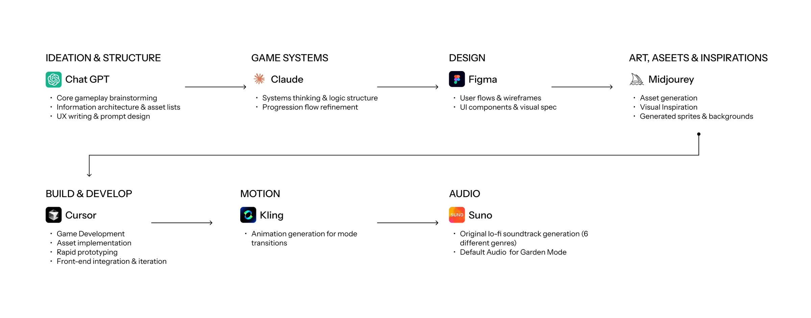
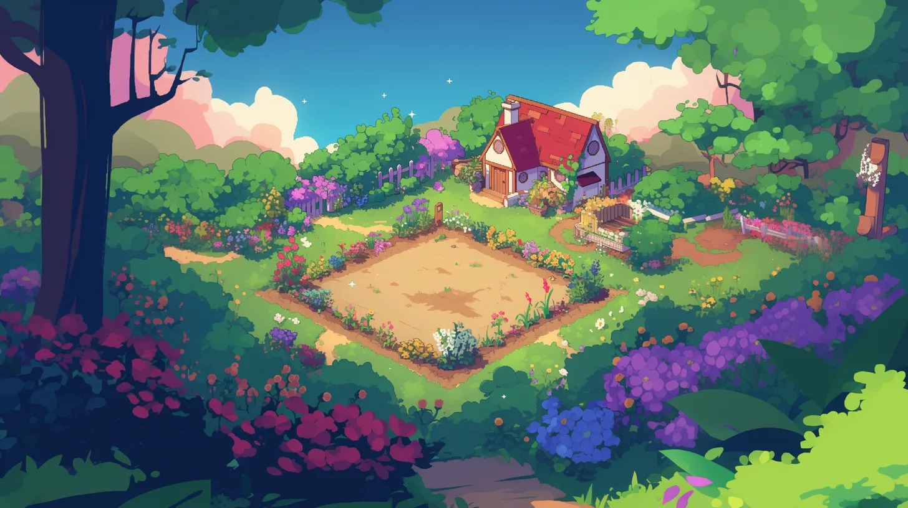
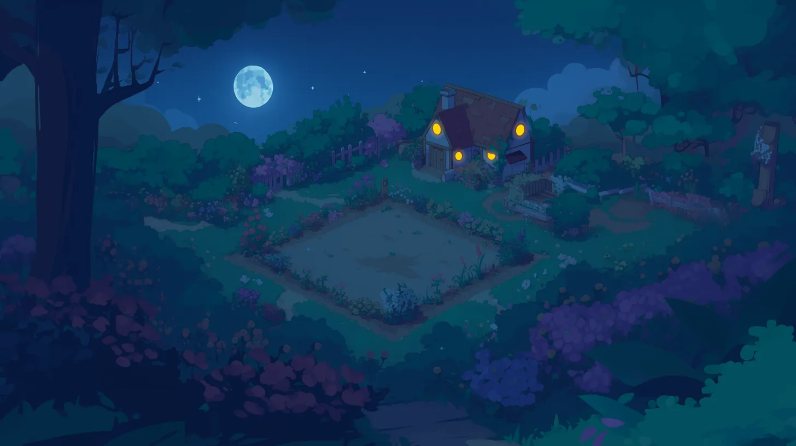
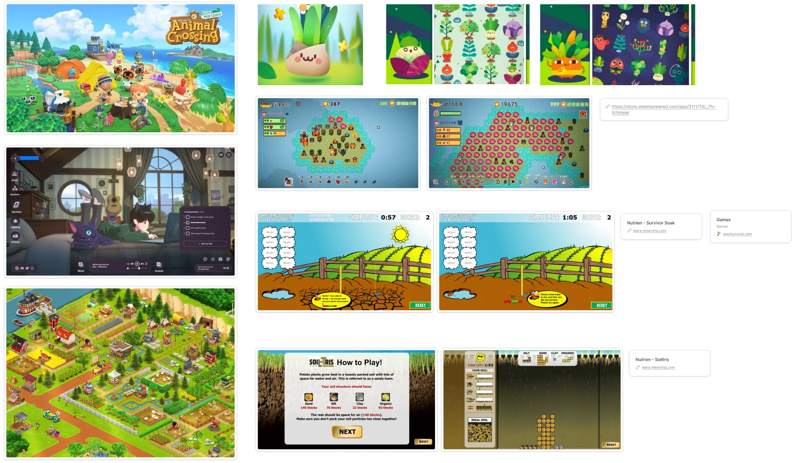
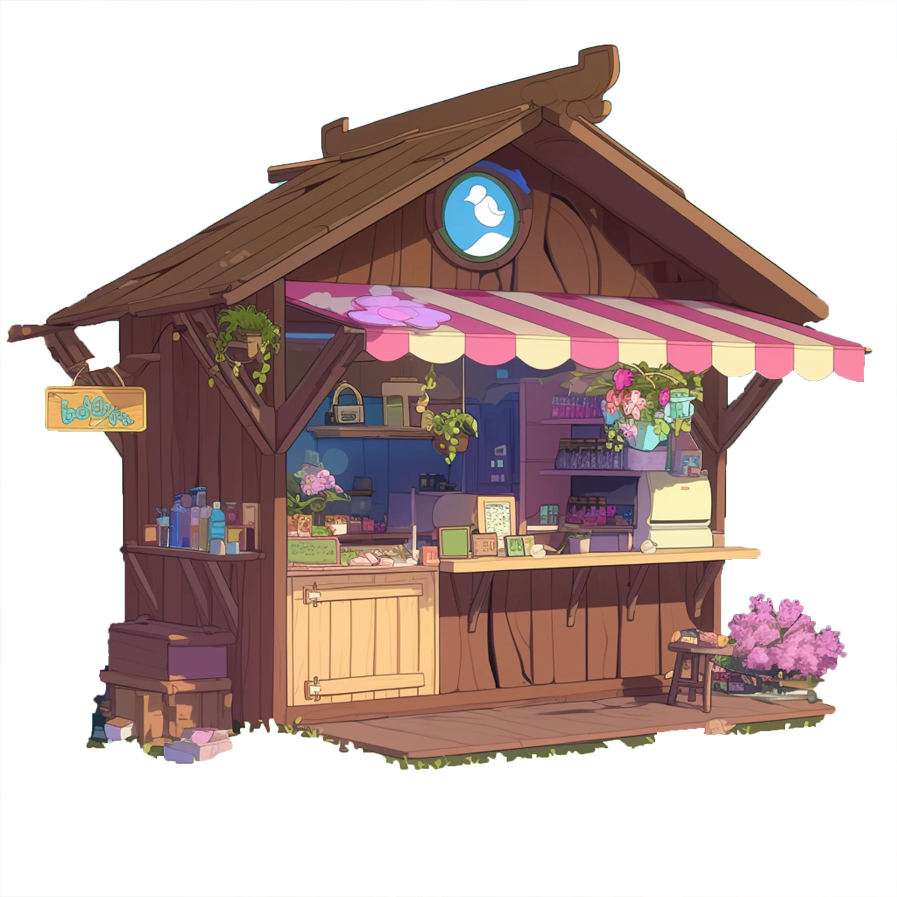

## Product glimpse

## AI workflow: accelerating design and development

I integrated AI tools throughout the design process to speed up iteration and expand creative exploration.

### Asset library: Midjourney

Every item, plant growth stage and scene in the game was generated with Midjourney, then curated and refined into one consistent cozy, lo-fi pixel style.

  

    

      <button type="button" data-filter="all" aria-pressed="true">All 31</button>
      <button type="button" data-filter="tools" aria-pressed="false">Items & rewards</button>
      <button type="button" data-filter="plants" aria-pressed="false">Plants & growth</button>
      <button type="button" data-filter="scenes" aria-pressed="false">Scenes</button>
    

    Scroll inside to see more ↓
  

  

    

    <figure class="lib__tile" data-cat="tools"><figcaption>Coin</figcaption></figure>
    <figure class="lib__tile" data-cat="tools"><figcaption>Sun</figcaption></figure>
    <figure class="lib__tile" data-cat="tools"><figcaption>Water</figcaption></figure>
    <figure class="lib__tile" data-cat="tools"><figcaption>Watering can</figcaption></figure>
    <figure class="lib__tile" data-cat="tools"><figcaption>Shovel</figcaption></figure>
    <figure class="lib__tile" data-cat="tools"><figcaption>Pesticide</figcaption></figure>
    <figure class="lib__tile" data-cat="tools"><figcaption>Focus</figcaption></figure>
    <figure class="lib__tile" data-cat="tools"><figcaption>Streak</figcaption></figure>
    <figure class="lib__tile" data-cat="tools"><figcaption>Caterpillar (pest)</figcaption></figure>
    <figure class="lib__tile" data-cat="tools"><figcaption>Garden shop</figcaption></figure>
    <figure class="lib__tile" data-cat="plants"><figcaption>Apple</figcaption></figure>
    <figure class="lib__tile" data-cat="plants"><figcaption>Blueberry</figcaption></figure>
    <figure class="lib__tile" data-cat="plants"><figcaption>Apple tree · stage 1</figcaption></figure>
    <figure class="lib__tile" data-cat="plants"><figcaption>Apple tree · stage 2</figcaption></figure>
    <figure class="lib__tile" data-cat="plants"><figcaption>Apple tree · stage 3</figcaption></figure>
    <figure class="lib__tile" data-cat="plants"><figcaption>Apple tree · stage 4</figcaption></figure>
    <figure class="lib__tile" data-cat="plants"><figcaption>Apple tree · stage 5</figcaption></figure>
    <figure class="lib__tile" data-cat="plants"><figcaption>Apple plot · stage 1</figcaption></figure>
    <figure class="lib__tile" data-cat="plants"><figcaption>Apple plot · stage 2</figcaption></figure>
    <figure class="lib__tile" data-cat="plants"><figcaption>Apple plot · stage 3</figcaption></figure>
    <figure class="lib__tile" data-cat="plants"><figcaption>Apple plot · stage 4</figcaption></figure>
    <figure class="lib__tile" data-cat="plants"><figcaption>Apple plot · stage 5</figcaption></figure>
    <figure class="lib__tile" data-cat="plants"><figcaption>Blueberry · stage 1</figcaption></figure>
    <figure class="lib__tile" data-cat="plants"><figcaption>Blueberry · stage 2</figcaption></figure>
    <figure class="lib__tile" data-cat="plants"><figcaption>Blueberry · stage 3</figcaption></figure>
    <figure class="lib__tile" data-cat="plants"><figcaption>Blueberry · stage 4</figcaption></figure>
    <figure class="lib__tile" data-cat="plants"><figcaption>Blueberry · stage 5</figcaption></figure>
    <figure class="lib__tile" data-cat="scenes"><figcaption>Garden</figcaption></figure>
    <figure class="lib__tile" data-cat="scenes"><figcaption>Garden · option 1</figcaption></figure>
    <figure class="lib__tile" data-cat="scenes"><figcaption>Garden · option 2</figcaption></figure>
    <figure class="lib__tile" data-cat="scenes"><figcaption>Garden · night</figcaption></figure>
    

  

### Background image and animation: Midjourney & Kling AI

## My role

I designed, developed, and deployed the project end-to-end, handling everything from concept and UI/UX to development and launch.

## Problem & goals

Traditional productivity tools often feel rigid and uninspiring, which makes it difficult for people to stay engaged over time. While timers and task lists provide structure, they rarely offer the sense of quick progress and reward that keeps users motivated.

  
Goal 01<h4>Make productivity engaging</h4>
Turn focus and productive work into something fun, rewarding, and interactive. Provide quick feedback, visible progress, and rewarding completion.

  
Goal 02<h4>Player retention via cozy game mechanics</h4>
Incorporate short reward loops, nurturing tasks, and playful progression inspired by games like Hay Day and Animal Crossing.

  
Goal 03<h4>Balance productivity with play</h4>
Blend structured focus with playful rewards, creating a system that builds consistency, motivation, and a sense of accomplishment.

## Target audience

  

    
M
<h4>Maya</h4>An overwhelmed college student

    <blockquote>“I lose focus easily. I wish productivity felt less like a chore and more like a game.”</blockquote>
    <dl>
      <dt>Pain points</dt><dd>Procrastinates, finds timers rigid, gets demotivated.</dd>
      <dt>Needs</dt><dd>Quick feedback, visible progress, a structured focus tool that won’t be distracting.</dd>
      <dt>Design response</dt><dd>Pomodoro timer + garden growth loop.</dd>
    </dl>
  

  

    
A
<h4>Alex</h4>A young professional

    <blockquote>“I need to get through long work sessions, but I burn out fast and lose track of tasks.”</blockquote>
    <dl>
      <dt>Pain points</dt><dd>Gets distracted, struggles to sustain attention, finds apps too plain.</dd>
      <dt>Needs</dt><dd>Calm environment, motivating rewards, a sense of accomplishment.</dd>
      <dt>Design response</dt><dd>Lo-fi soundtrack, calming visuals, day/night animation and weather integration.</dd>
    </dl>
  

## User research

To understand why productivity apps often fail to keep users motivated, I looked at how playful, nurturing systems sustain engagement. Unlike rigid task-based tools, these systems create quick reward loops, visible progress, and immersive environments that encourage consistency over time. Drawing from these patterns, I explored how similar mechanics could reframe productivity as something more rewarding and enjoyable.

## Design process

### Visual research and inspiration

I studied cozy, nurturing games — Animal Crossing, Hay Day and plant-growing puzzle games — alongside lo-fi focus apps, looking at how they reward small actions and make progress visible.

### Userflow

The core experience was mapped in three phases, plus a monetization flow.

  <figure class="flows__p1"><figcaption>Phase 1 Core loop</figcaption></figure>
  <figure class="flows__p2" style="--ar:.768"><figcaption>Phase 2</figcaption></figure>
  <figure class="flows__p3" style="--ar:.656"><figcaption>Phase 3</figcaption></figure>
  <figure class="flows__m" style="--ar:.267"><figcaption>Monetization</figcaption></figure>

## Key implementation features

  
<h4>Focus mode</h4><ul><li>Pomodoro timer + to-do list</li><li>Custom AI-generated lo-fi soundtrack</li></ul>

  
<h4>Garden mode</h4><ul><li>Planting, tending, and harvesting system</li><li>Purchase items at the garden shop</li><li>Harvest fruit for rewards</li></ul>

  
<h4>Reward loop</h4><ul><li>Quick progress feedback via visual plant growth</li><li>Earn money and rewards through growing and harvesting</li></ul>

  
<h4>Environmental integration</h4><ul><li>Real-time weather reflected in-game</li><li>Weather simulator for different conditions</li></ul>

  
<h4>AI-accelerated workflow</h4><ul><li>Asset generation, music creation, prototyping</li><li>Shipped from concept → deploy in 1 month</li></ul>

  
<h4>Deployment</h4><ul><li>Designed, built and deployed a working online game</li><li>End-to-end execution</li></ul>

## Final product & special game features

### Full game walkthrough (with audio)

Full game walkthrough with audio — add a YouTube/Vimeo link or a short video here

### Focus mode: timer, to-do list, lo-fi soundtrack

Designed to support deep work sessions, Focus Mode combines a Pomodoro timer, to-do list, and an original set of AI-generated lo-fi tracks created specifically for the game.

### Garden mode: planting, harvesting, tending, garden shop

Turn productivity into play by planting, tending, and harvesting crops. Completed tasks grow your garden, while the shop adds rewards and progression.

### Environmental features: real-time weather, weather simulation through API

The game tracks the player’s location and mimics real-time weather conditions within the game, creating a more immersive and personalized experience.

## Impact & outcome

This project taught me how to balance ambition with usability, adapt quickly through iteration, and keep clarity and user experience at the core. Most importantly, it showed me that even solo projects can become proof-of-concept products when approached with structure, iteration, and focus.

  
<h4>Timeline</h4>
Completed and deployed in one month, demonstrating efficiency under tight deadlines.

  
<h4>Design cycle</h4>
Managed the entire design cycle: research, information architecture, UI/UX, prototyping, and development.

  
<h4>AI acceleration</h4>
Leveraged AI tools to streamline workflows, explore creative directions, and facilitate execution.

  
<h4>Initiative</h4>
Brought the project from concept to launch independently, showing adaptability and ownership.

