During my internship at Animoca Brands, I was tasked with designing and integrating a new gameplay feature called **Gambit Mode** — a token-based competitive system that allows players to place buy-ins and compete for higher-stake rewards. My goal was to design a frictionless, intuitive experience that simplified blockchain interactions while aligning with the product’s business objectives.

## Product glimpse

## My role

I collaborated with product designers and developers to improve player experience and engagement through interface redesigns that simplified complex blockchain mechanics. My role focused on aligning user experience with monetization goals, refining the leaderboard and homepage UI, and ensuring visual consistency across the existing design system.

## Problem & goals

Early prototypes of the buy-in process were overly complex, requiring too many steps and unclear terminology for players unfamiliar with token-based gameplay. The challenge was to introduce a new monetization system into an existing, high-traffic game without disrupting player flow or creating friction around blockchain mechanics.

  
Goal 01<h4>Simplify blockchain interactions for players</h4>
Make token-based gameplay intuitive for both new and experienced users by simplifying complex blockchain mechanics into clear, approachable actions.

  
Goal 02<h4>Seamlessly integrate Gambit Mode into the existing game</h4>
Adapt navigation patterns, reconfigure layouts, and make sure the new mode works consistently across screens without disrupting current user habits.

  
Goal 03<h4>Create an engaging, efficient monetization experience</h4>
Develop a competitive environment where users can stake tokens with minimal effort and maximum clarity.

## Target audience

  

    
T
<h4>Tim</h4>Casual chess player (Web2 user)

    <blockquote>“I want to play chess competitively without needing deep blockchain knowledge.”</blockquote>
    <dl>
      <dt>Pain points</dt><dd>Finds token systems confusing; intimidated by crypto terminology.</dd>
      <dt>Needs</dt><dd>Clear instructions, a simple buy-in process, visual feedback for successful transactions.</dd>
      <dt>Design response</dt><dd>Intuitive flows that hide technical complexity behind familiar game mechanics.</dd>
    </dl>
  

  

    
J
<h4>Jess</h4>Web3 gamer & blockchain enthusiast

    <blockquote>“I want to compete for rewards using tokens, but if the interface slows me down and stakes are unclear, I lose interest.”</blockquote>
    <dl>
      <dt>Pain points</dt><dd>Frustrated by slow or redundant confirmation steps; wants transparency in staking and rewards.</dd>
      <dt>Needs</dt><dd>A fast, efficient transaction flow and clear visibility of token balances and potential winnings.</dd>
      <dt>Design response</dt><dd>Efficiency and instant clarity, while keeping the competitive excitement.</dd>
    </dl>
  

## User research

To understand how Gambit Mode would fit real player behaviour and the wider industry, I researched three areas:

  
01<h4>Competitive game analysis</h4>
Studied gameplay and reward systems in existing games to see how tokenized or high-stakes modes keep players motivated — revealing the need for transparent reward structures, clear hierarchy, and minimal friction between joining and playing a match.

  
02<h4>Web3 & blockchain ecosystem</h4>
Researched how token-based transactions and smart contracts work, so the staking and buy-in processes could be represented clearly through the UI.

  
03<h4>Player behaviour & onboarding</h4>
Players wanted straightforward confirmation steps and visible indicators of a successful buy-in — both critical for trust and usability.

> **Key insight:** players were motivated by clarity and efficiency.

## Existing game screens

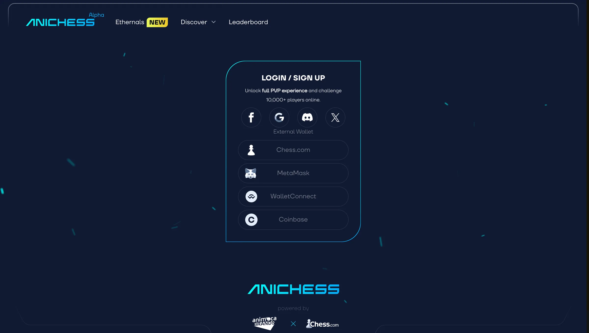
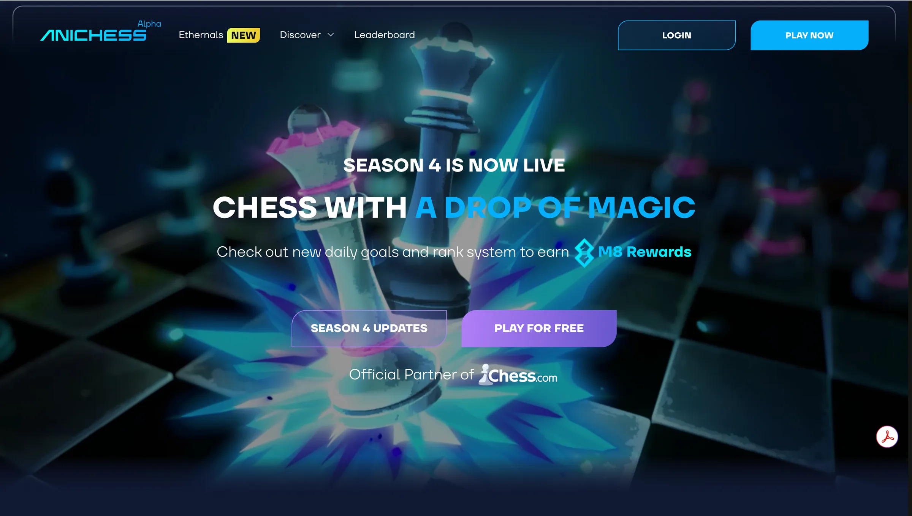
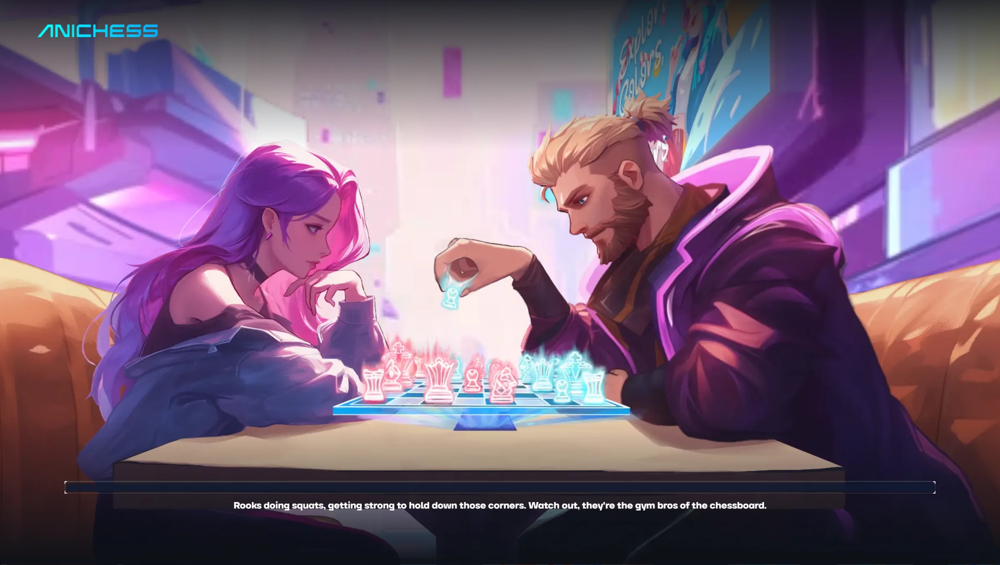

## Research & visual inspiration

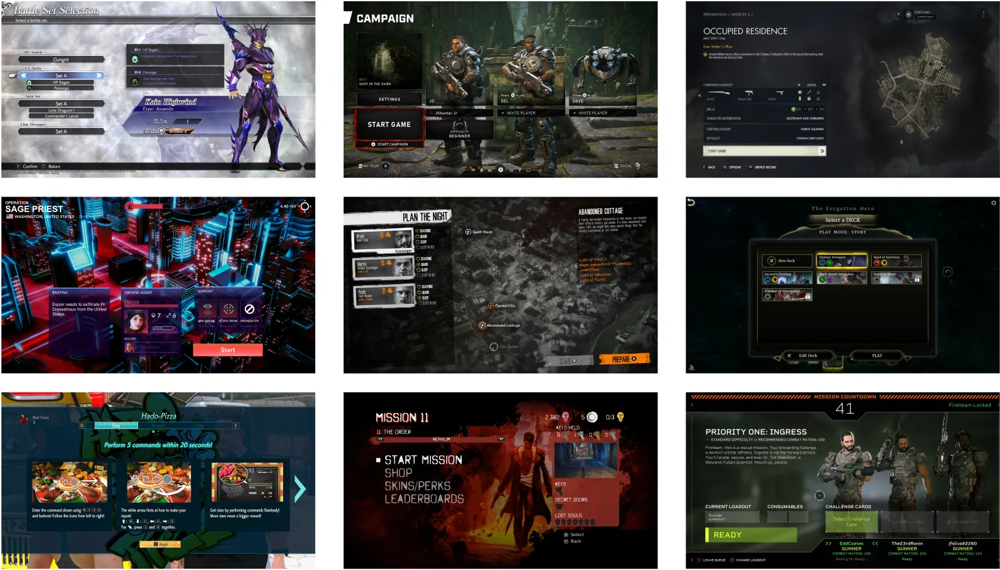

## Redesigned lobby screen

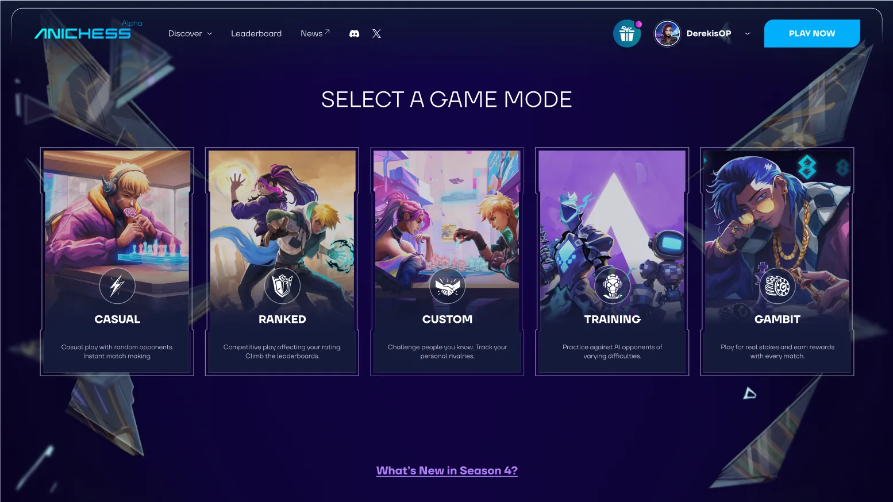

## User flow & low-fidelity wireframes

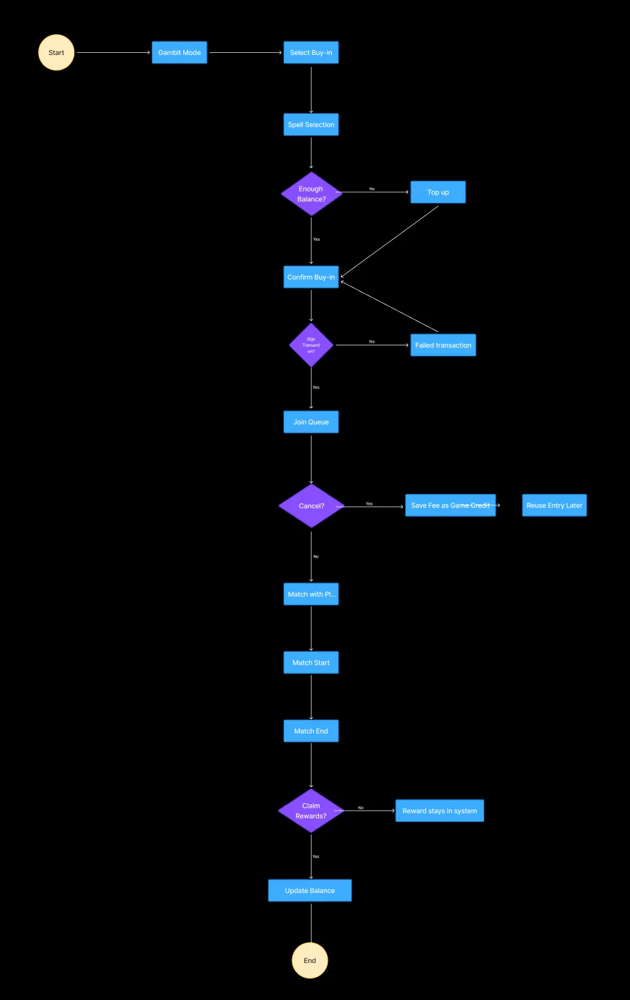
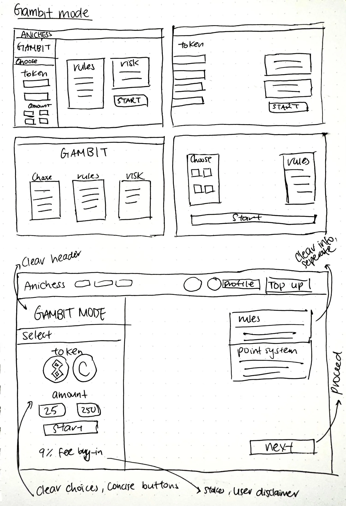

## Visual design & UI assets

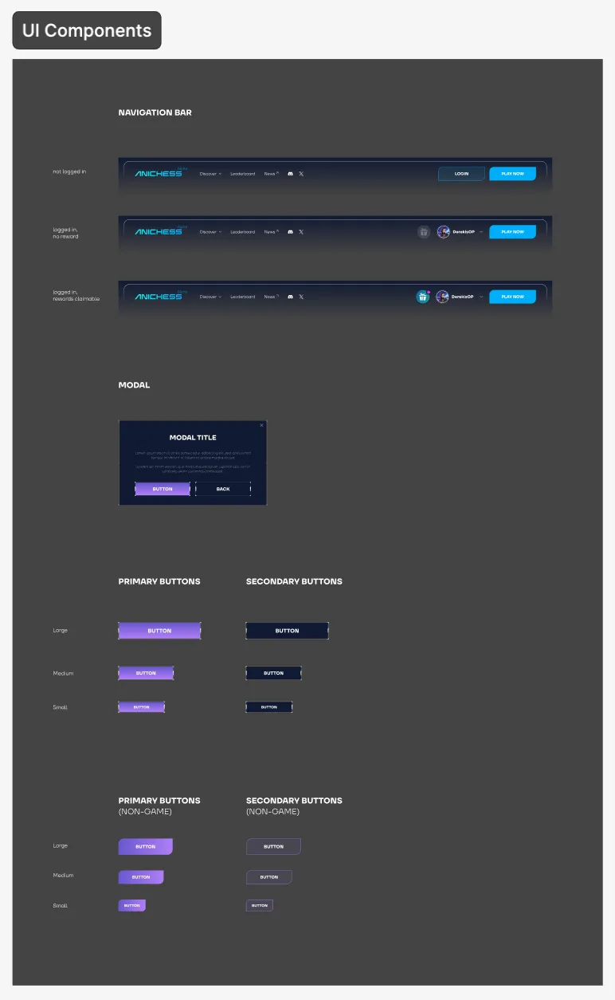
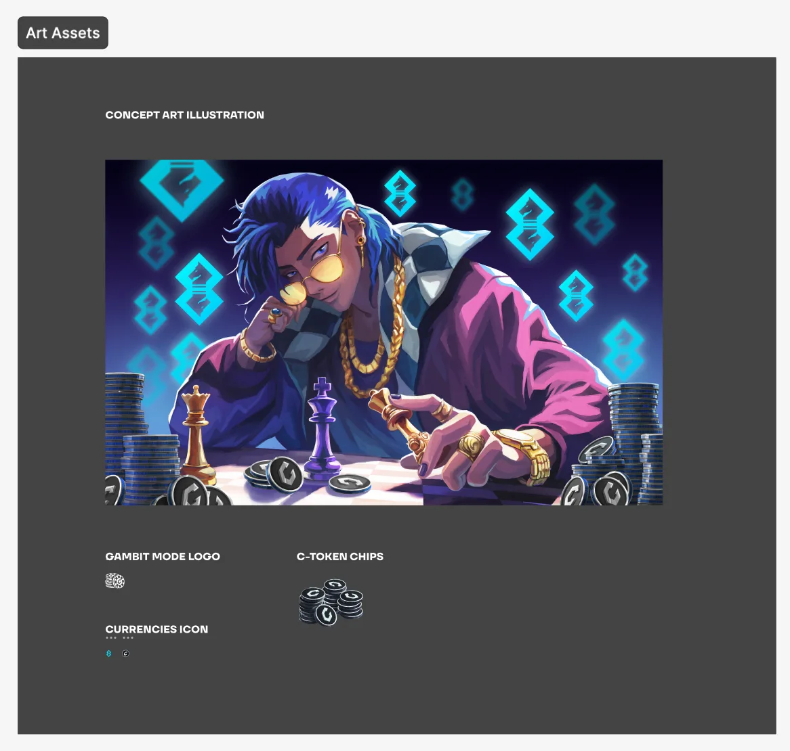

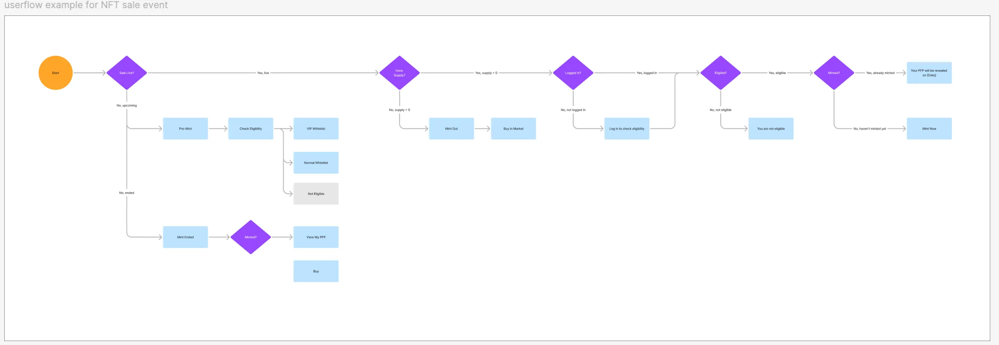

## Mid-fidelity wireframes

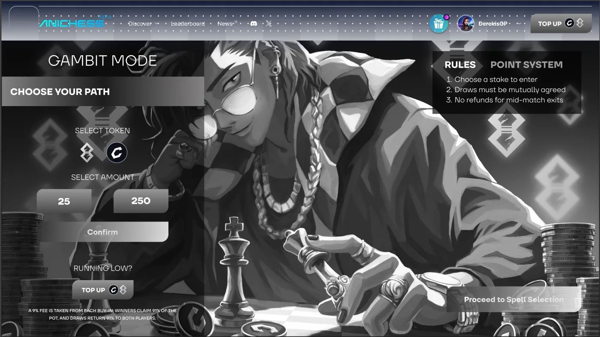
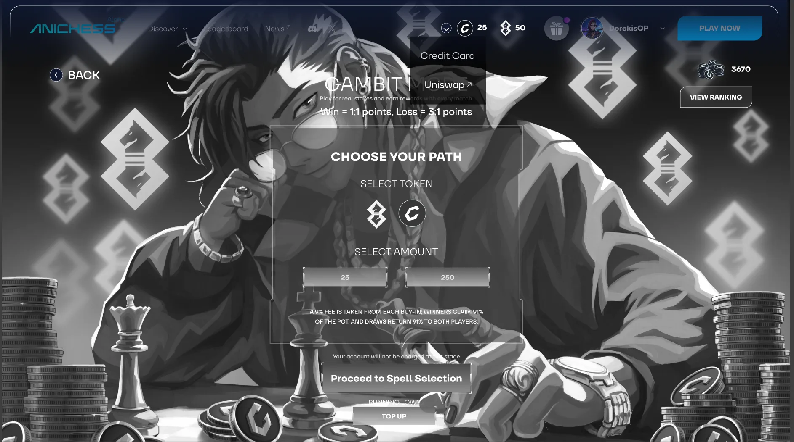

## High-fidelity wireframes

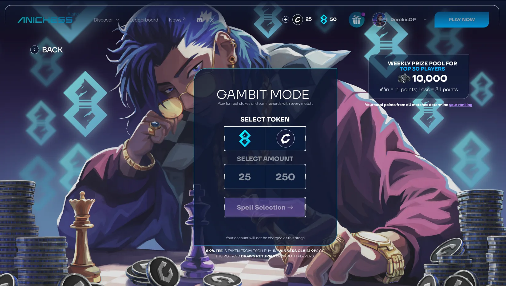

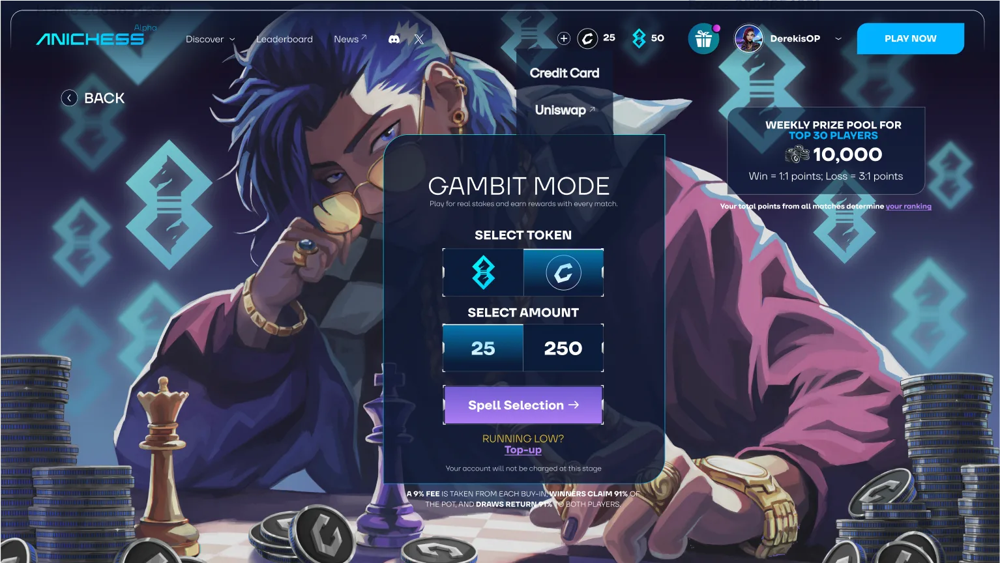
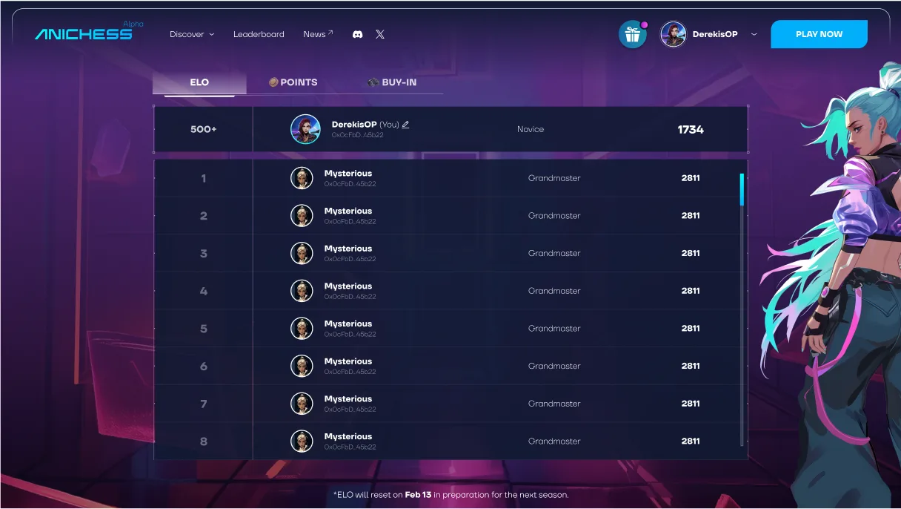

## Redesigned prototype

## Officially launched design

## Impact & outcome

This project taught me how to translate complex blockchain systems into intuitive gameplay experiences. Collaborating with designers and developers helped me learn how to adapt creative direction within product and technical constraints, while maintaining user clarity and accessibility. It also showed me how thoughtful UX design can make emerging technologies like Web3 feel familiar and enjoyable for everyday players.

  
<h4>Timeline</h4>
Designed and prototyped within two weeks, contributing directly to a feature integrated into the official Anichess launch.

  
<h4>Design cycle</h4>
Contributed across the full process — competitive analysis, user flow mapping, UI systems, prototyping and usability testing — while keeping consistency with the existing game.

  
<h4>Collaboration</h4>
Attended weekly team meetings and worked with product designers and engineers, sharing progress, taking feedback and refining so the feature integrated smoothly.

  
<h4>Integration & outcome</h4>
Gambit Mode launched within Anichess with a simplified buy-in flow, clear staking hierarchy and improved player feedback.

