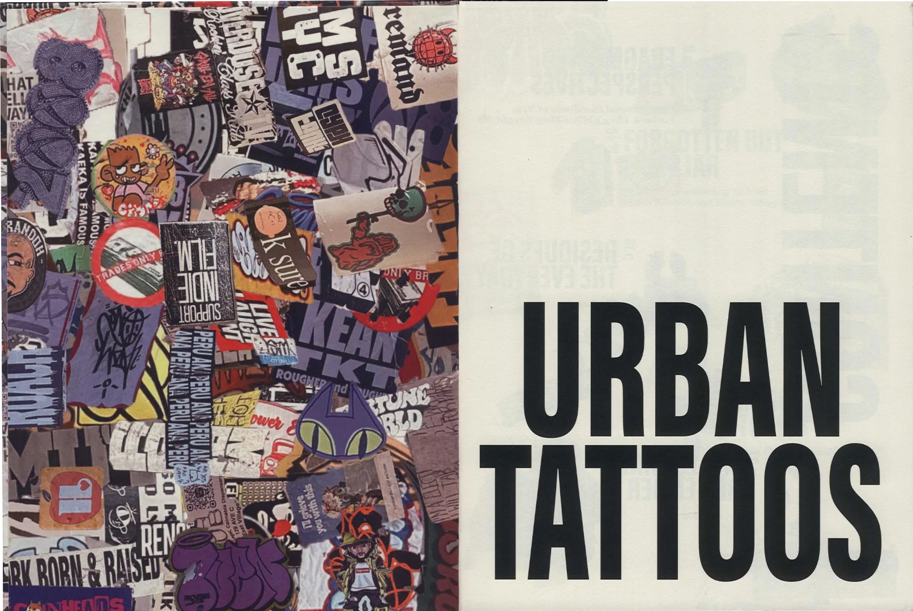
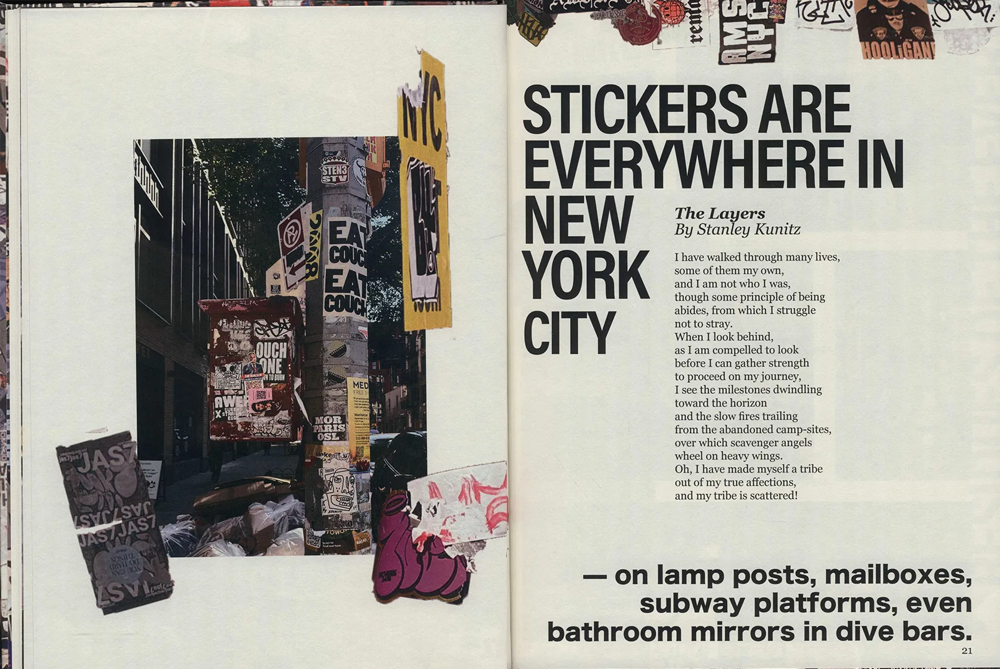
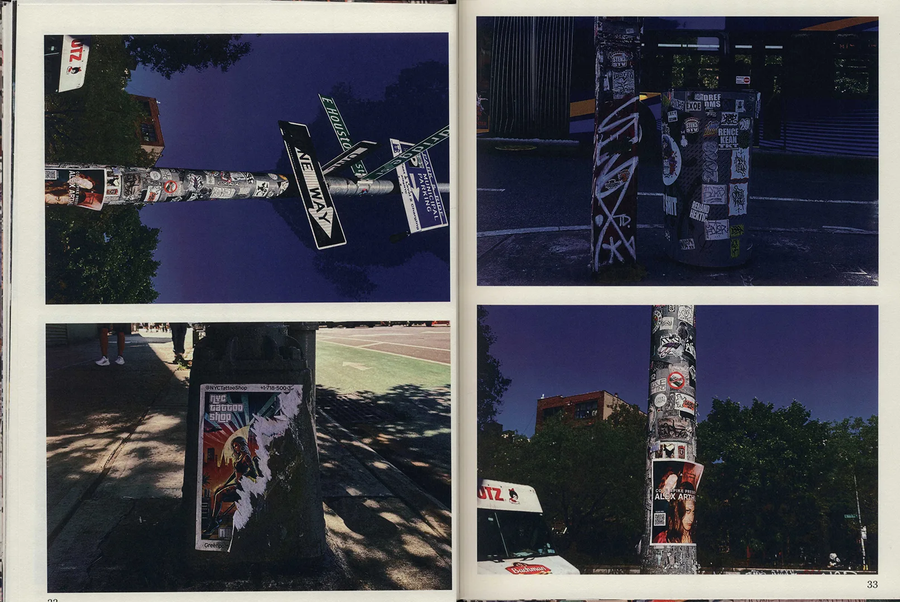
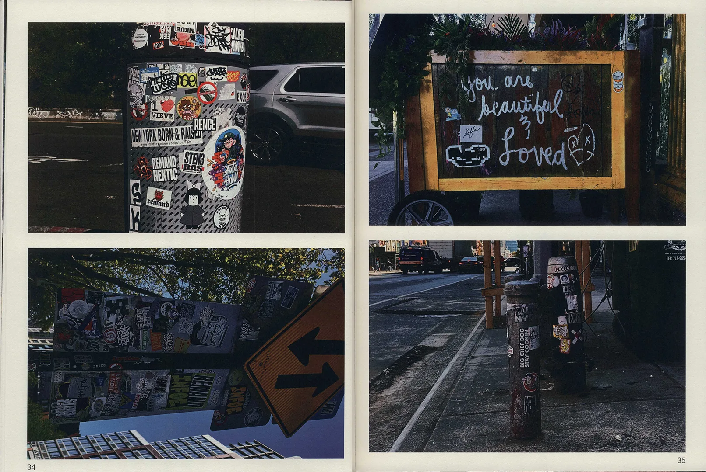

Urban Tattoos translates the impermanent marks of city life into print. It is an editorial coffee table book that explores how design can preserve urban expression. Compiling stickers and wall fragments collected from across New York, the publication uses layered photography, typography and layout to reflect the texture, depth and impermanence of street culture.

## Book spreads

## Online experience

An interactive website prototype that translates the visual chaos of city sticker culture into a dynamic digital archive. The experience reimagines urban stickers as meaningful artefacts through personalised curation, archival storytelling and an augmented reality feature. Users can browse the archive to learn the story behind each sticker, customise and save their own collection, and explore longer stories from the streets of New York.

## Augmented reality

Digitally tap and place stickers. Scanning the QR code on the website opens an augmented reality experience built in 8th Wall. With a simple tap-to-place interaction, users can preserve their favourite stickers and digitally stick them in new spaces, giving these short-lived marks a second life beyond the street.

  <figure style="--ar:0.461"><video src="/media/urban-tattoos/online-experience.mp4" autoplay muted loop playsinline data-expand aria-label="Augmented reality tap-to-place stickers"></video></figure>

