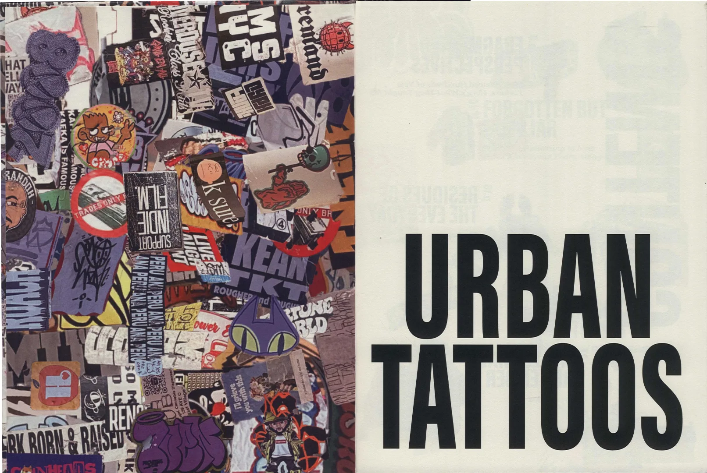
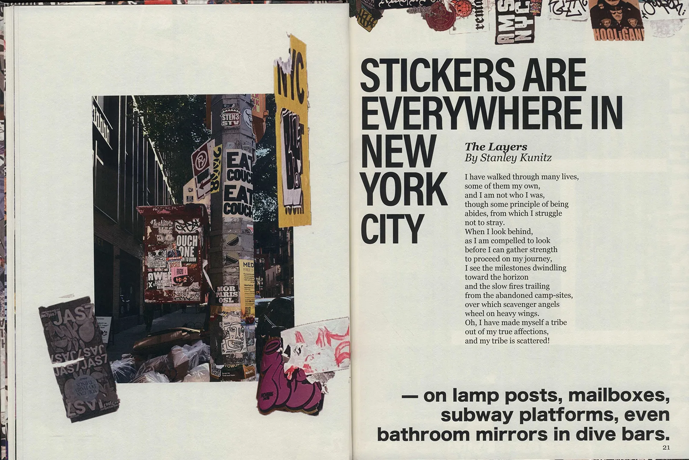
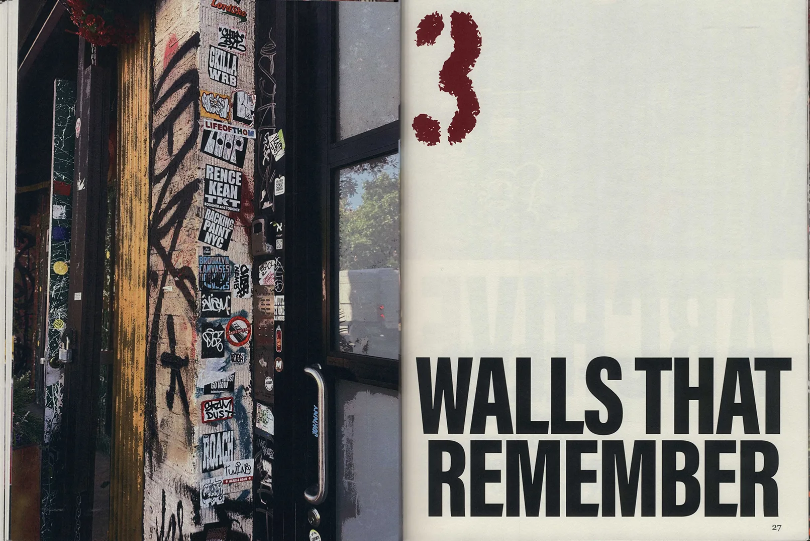
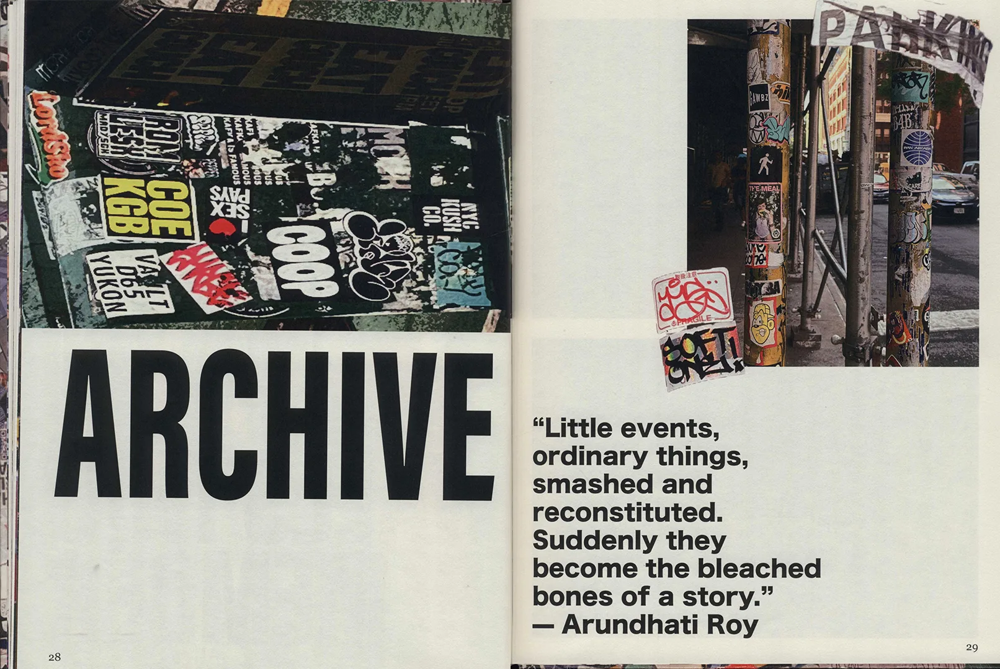
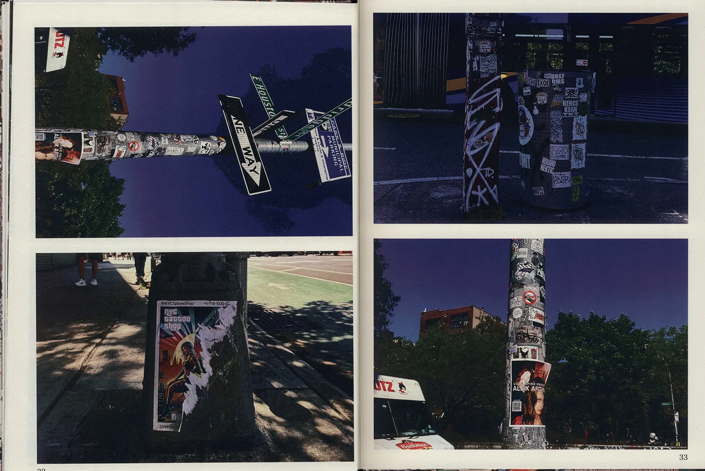
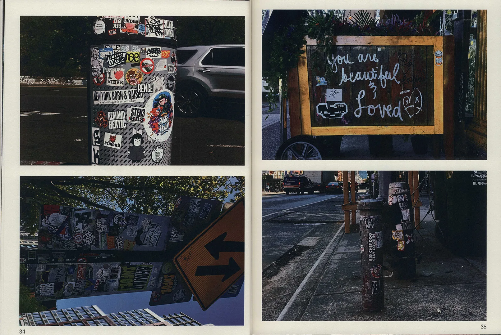
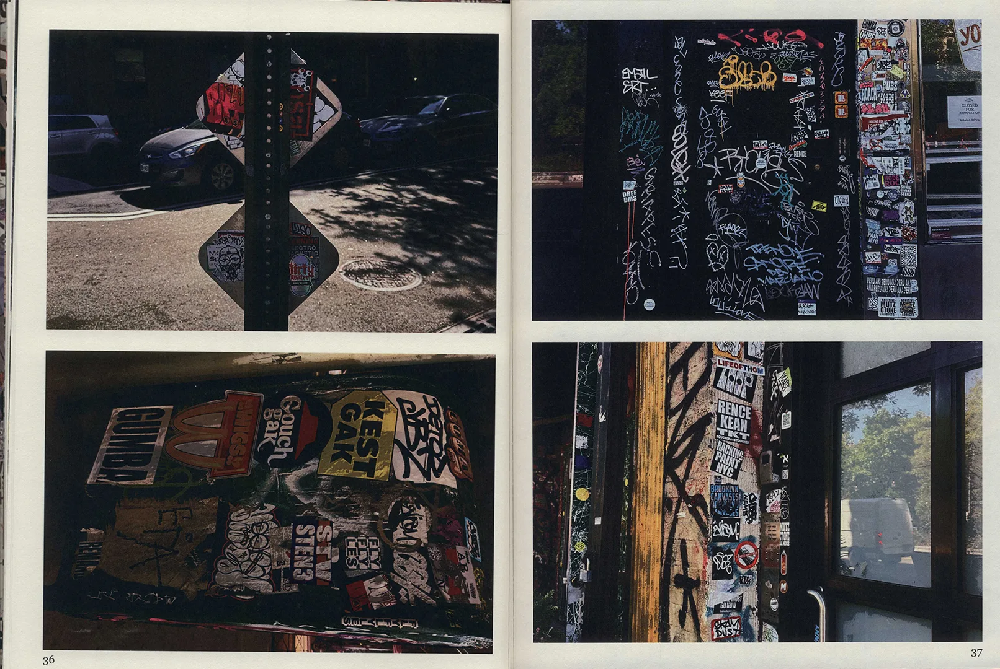
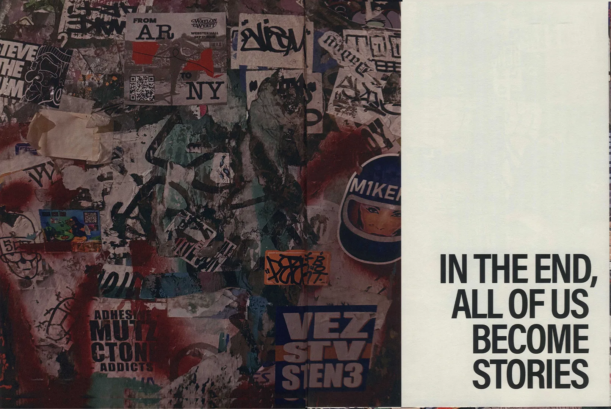

[Two or three sentences: the stickers you collected, where, and what they say about the city.]

## Spreads

## Online experience

[How the archive works on screen.]

## Credits

[Course, collaborators.]
