This project focused on the creative direction and branding of an emerging Spotify artist. I designed the album cover, led photoshoots, and developed a cohesive visual identity that reflected both the artist’s sound and personality.

## Visual inspiration

Moodboard and inspiration images that set the direction for the cover and the shoots.

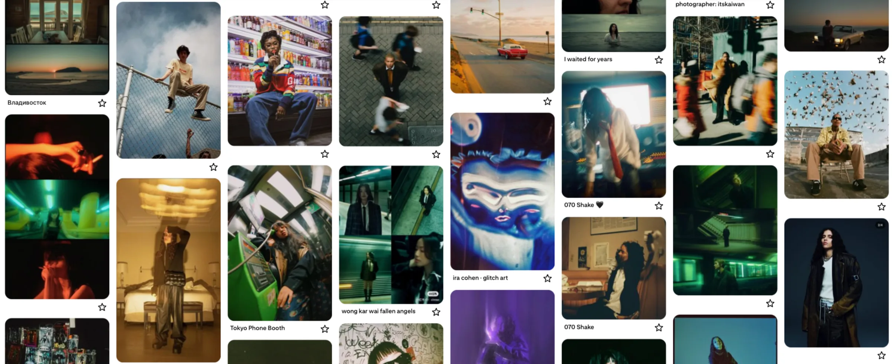

## The photoshoot

Creative direction, photography and editing. I directed and edited the photoshoots, ensuring that the imagery felt unified across platforms and visually connected to the album’s core aesthetic.

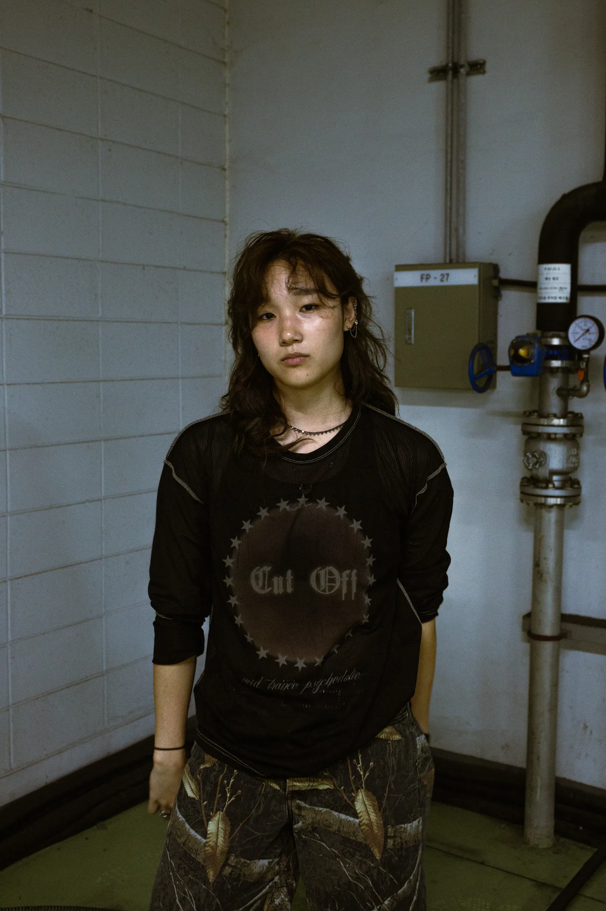
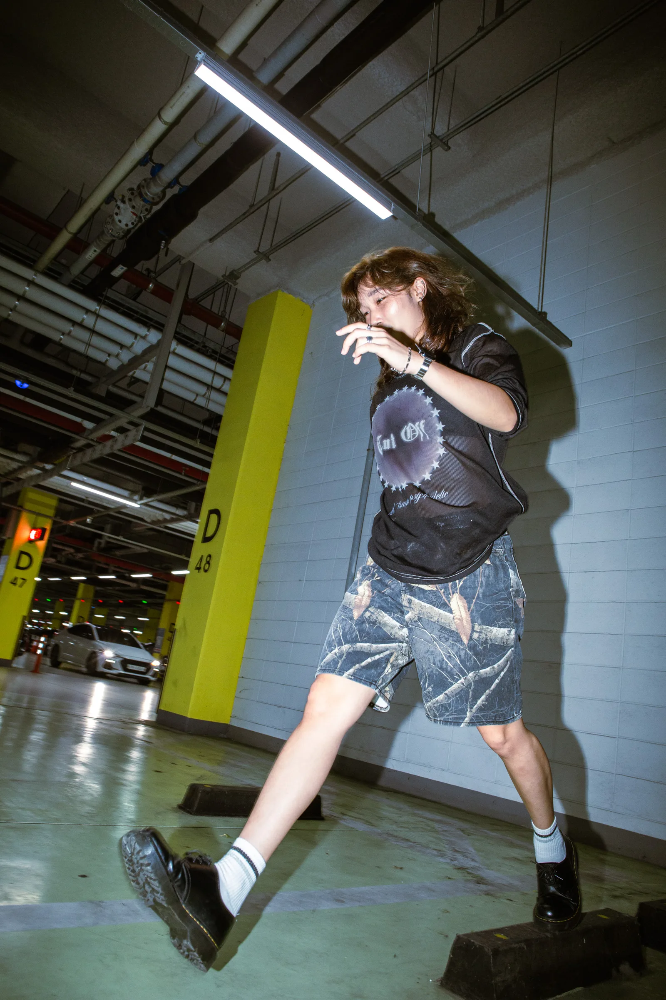
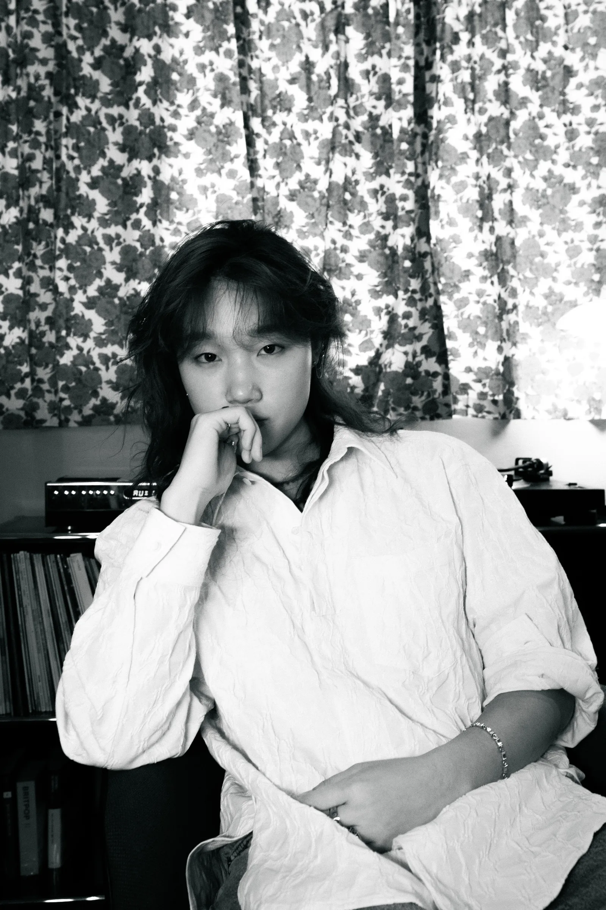
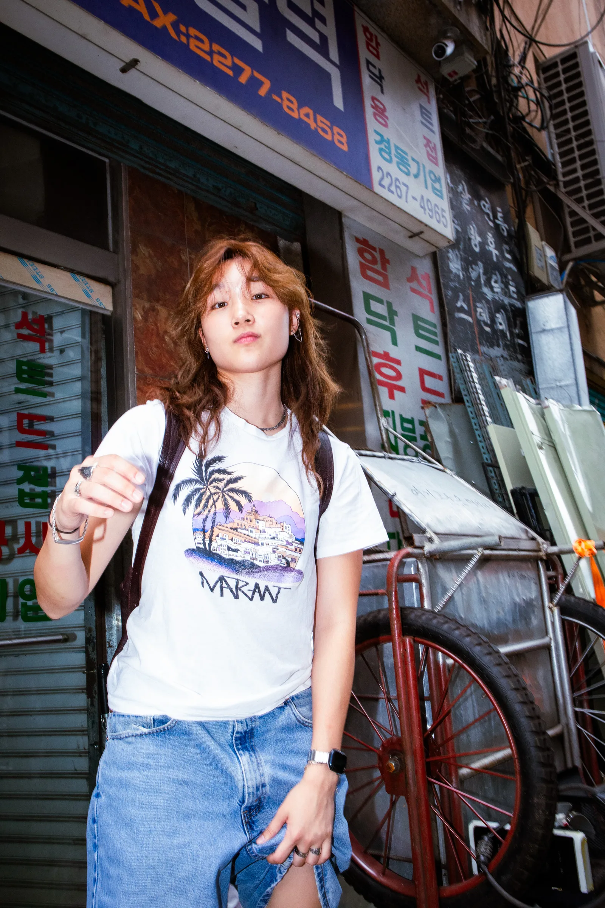
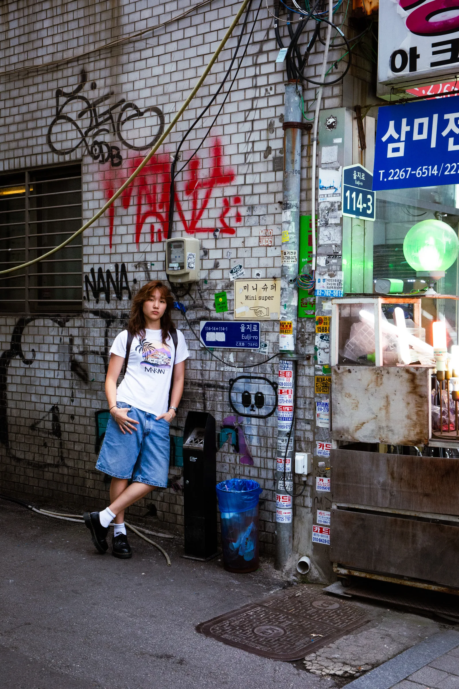
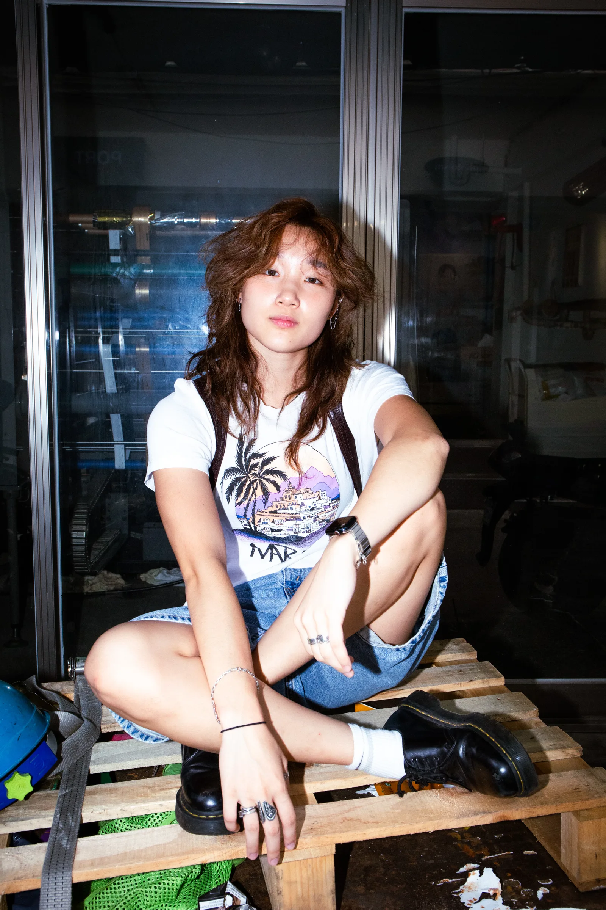
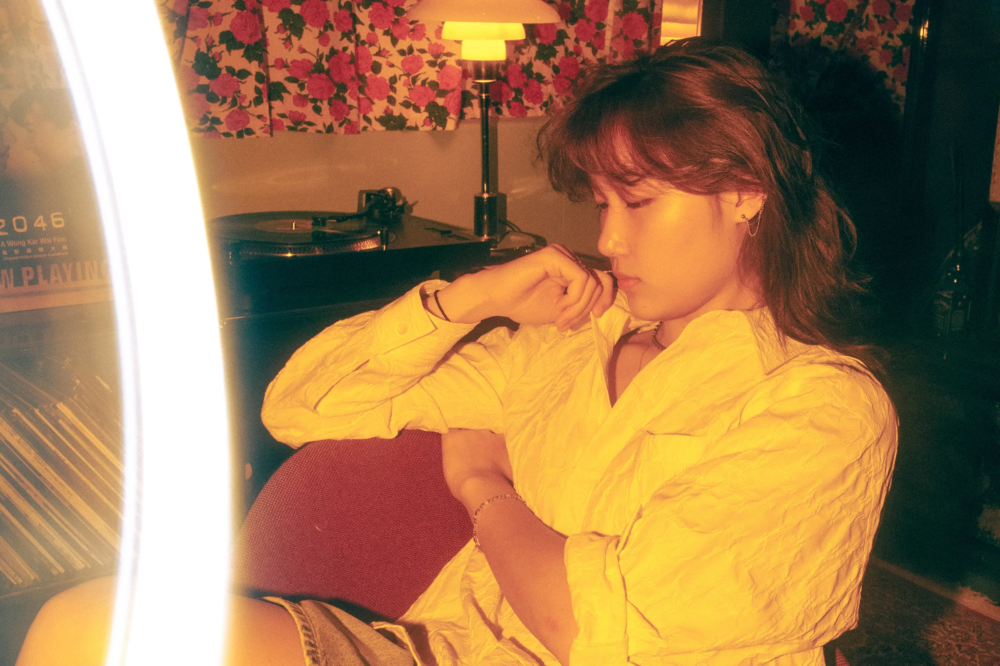
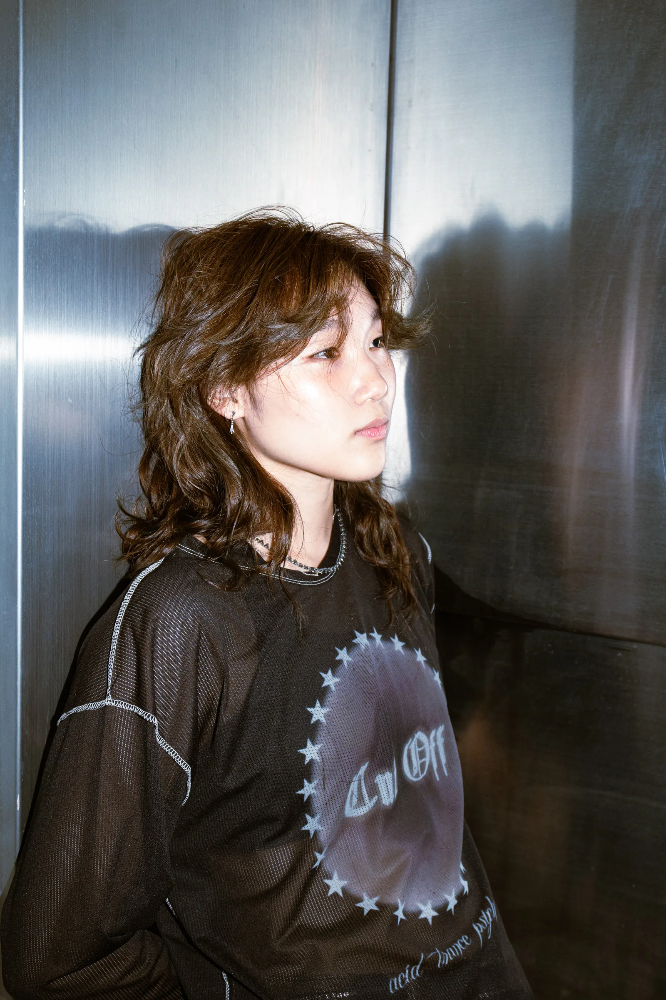
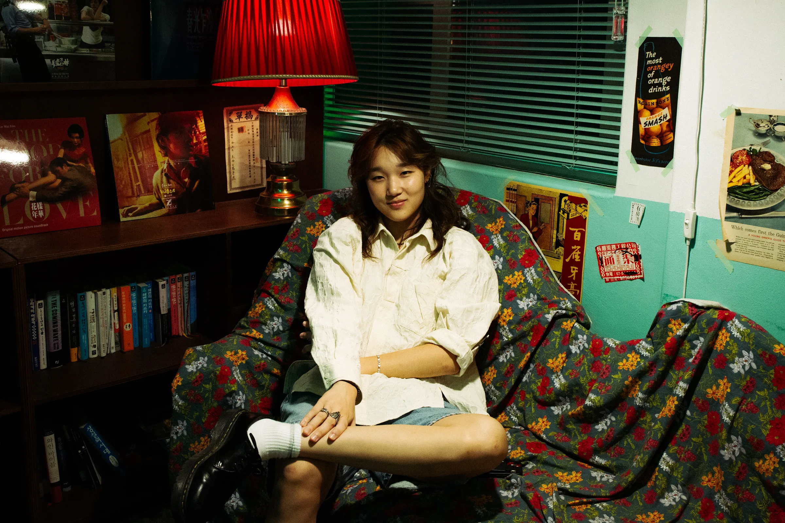
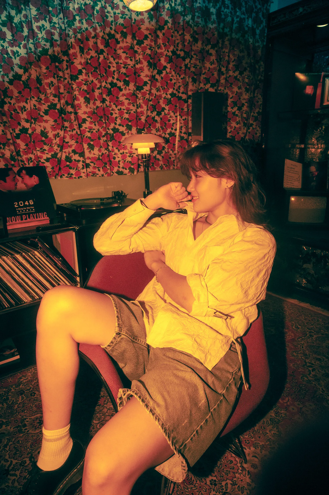

## Album cover design

The cover concept was developed and designed by me, drawing from my interest in surrealist art and blending it with bold graphic design to match the tone of the album. Below is the design progression, from the first sketch to the final design.

  <figure style="--ar:.65"><figcaption><b>Concept sketch</b></figcaption></figure>
  <figure style="--ar:1.017"><figcaption><b>Progression 01</b></figcaption></figure>
  <figure style="--ar:1.016"><figcaption><b>Progression 02</b></figcaption></figure>
  <figure style="--ar:1"><figcaption><b>Progression 03</b></figcaption></figure>

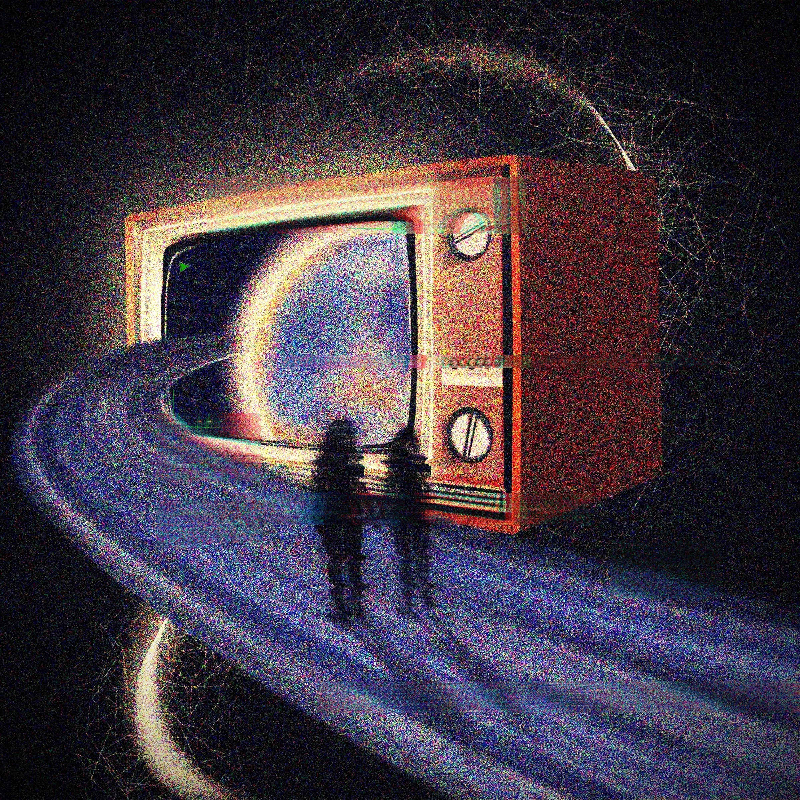

## On Spotify and social

The final cover on the song page and across the artist’s Spotify profile, with the photoshoot imagery carried into her socials so every platform felt connected to the album.

  <figure style="--ar:.593"><figcaption><b>Spotify</b>Song page</figcaption></figure>
  <figure style="--ar:.63"><figcaption><b>Instagram</b>Artist profile</figcaption></figure>

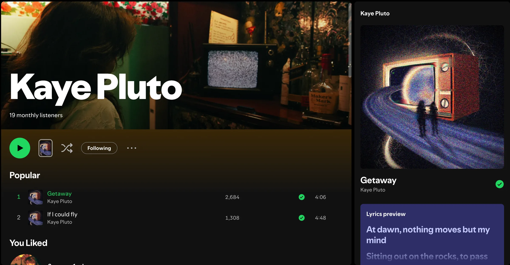
