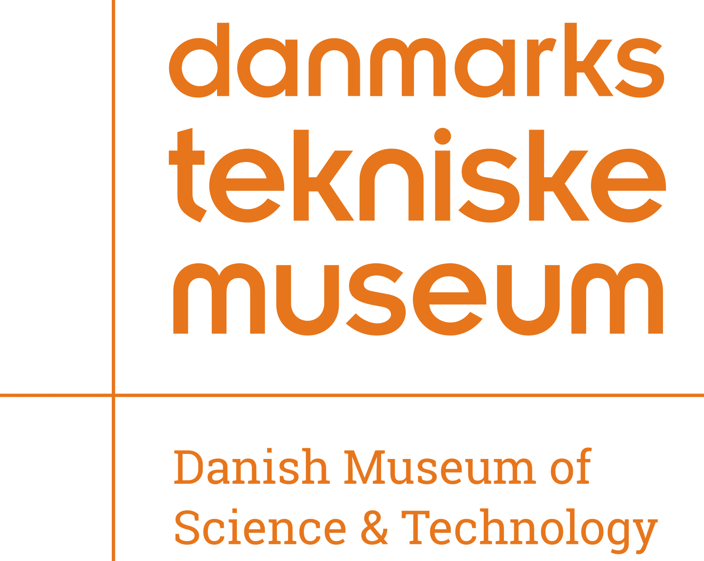

This project focused on the rebrand of Danmarks Tekniske Museum, the Danish Museum of Science and Technology. The museum welcomes a wide audience, from school groups to engineers, so the goal was to create an identity that reflected science and technology while still feeling approachable for every age.

## Original identity

The original identity relied on a wordmark alone. Its soft, rounded typeface felt friendly, but it did not communicate science or technology, and without a visual element there was nothing for visitors, especially younger ones, to recognise and remember.

## Logo

I designed an icon to sit beside the wordmark: a geometric, stepped silhouette. It gives the museum a symbol that can work on its own, on tickets, signage or an app icon, and it can be drawn as a solid shape or as a single continuous line. [Add what the silhouette represents, e.g. the museum's building or an industrial skyline.]

## Typography

I replaced the rounded typeface with a geometric, condensed one. Its tight, upright forms feel sleek and engineered, reflecting the precision of the machines and inventions inside the museum.

## Colour system

Because the museum speaks to all ages, the identity is built around colour. Each colour pairing keeps the logo recognisable while allowing exhibitions, seasons and audiences to have their own personality, ensuring the brand feels serious enough for adults and playful enough for children.

## Posters

## Tickets

Each ticket type has its own colour and line drawing, turning the tickets into small collectibles that visitors can keep after their visit.

## Applications

