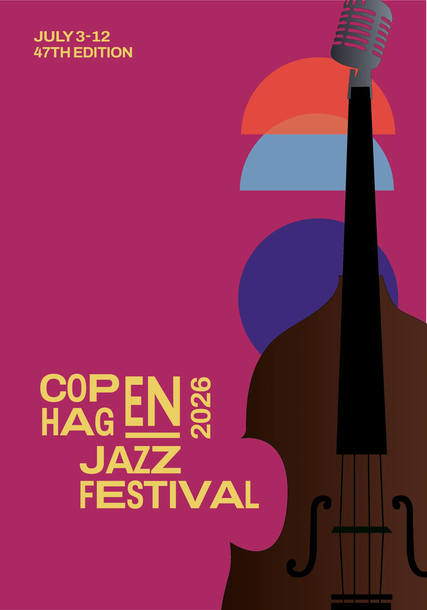
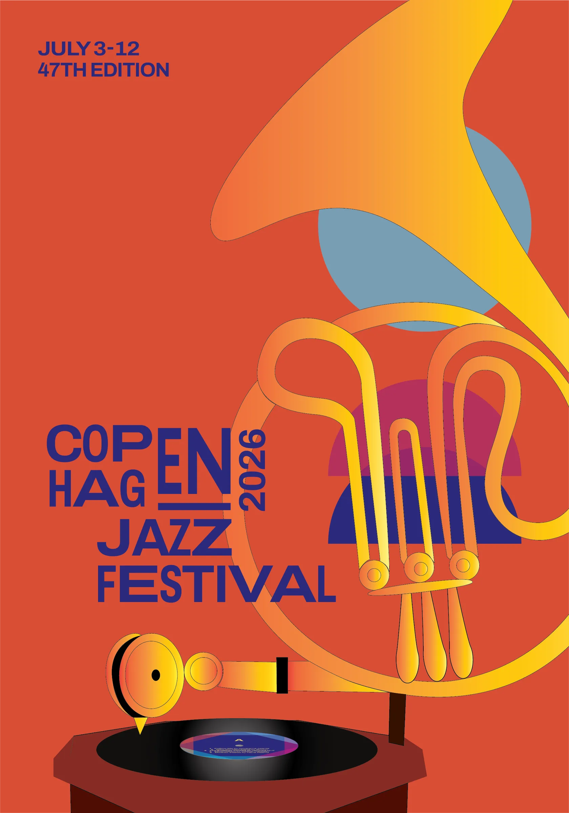
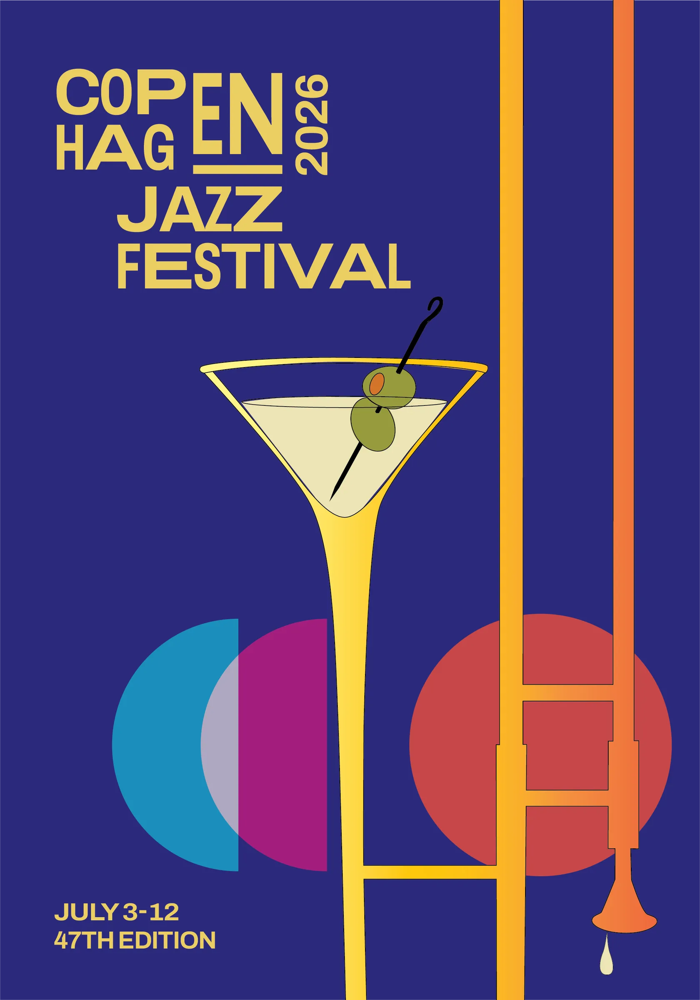
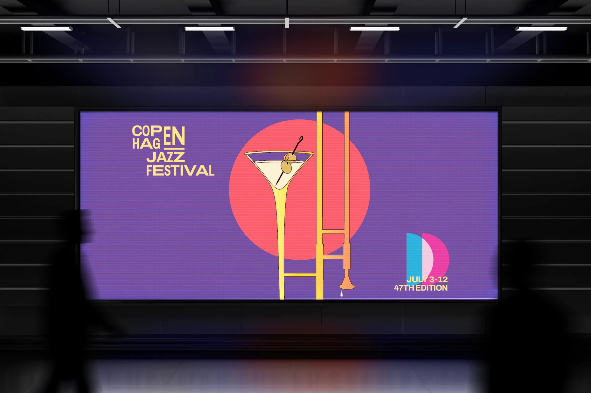
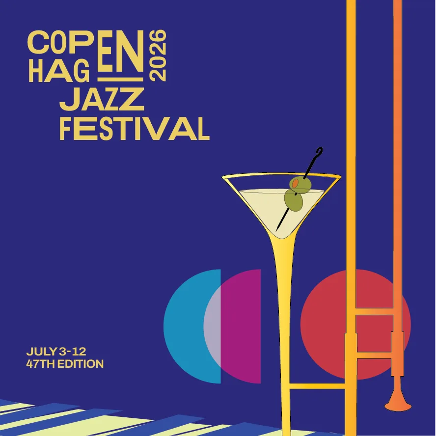
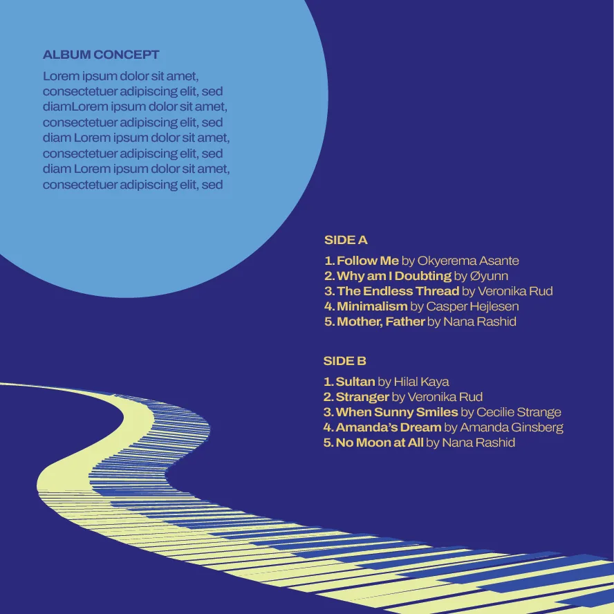
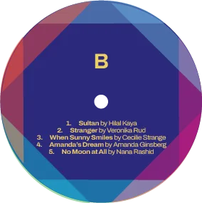
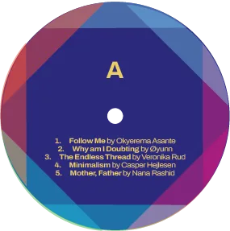
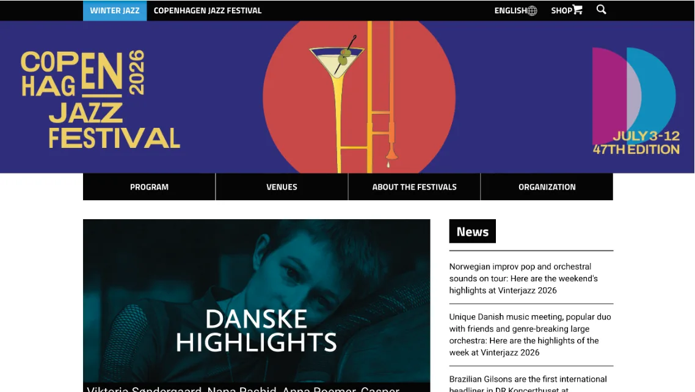

This project focused on creating an identity for Copenhagen Jazz Festival that stays true to the Danish design style. The festival has been around for many years, so I wanted to respect its traditional design while adding a modern twist. I did this by focusing on the forms of the instruments and merging them with other objects associated with jazz, pairing the trombone with a martini glass, the double bass with a vintage microphone and the French horn with a vintage record player. Combined with playful typography that conveys movement, the aim was to create something eye-catching that still feels rooted in the festival's history.

## Process

I began by sketching each instrument as a simple line drawing, then explored how far it could be pushed in scale. Some layouts let a single instrument fill the whole frame, while others paired it with smaller objects like the gramophone and the martini glass, which helped me see how the balance of the composition changed.

  <figure style="--ar:0.7"></figure>
  <figure style="--ar:0.7"></figure>
  <figure style="--ar:0.7"></figure>
  <figure style="--ar:0.7"></figure>

  <figure style="--ar:0.7"></figure>
  <figure style="--ar:0.7"></figure>
  <figure style="--ar:0.7"></figure>
  <figure style="--ar:0.7"></figure>
  <figure style="--ar:0.7"></figure>
  <figure style="--ar:0.7"></figure>

Colour became the main focus. I tested the same layouts across many colour combinations, as well as solid black silhouettes, to find pairings that felt bold while still feeling balanced. The direction draws on Scandinavian design, keeping everything simple, minimalist and functional so that the visuals emphasise clarity and a sense of natural simplicity. Anything that didn't serve this, such as the busier illustrated scene, was stripped back.

## Posters

## Records

## Website

## Motion

## Credits

[Course, collaborators.]
