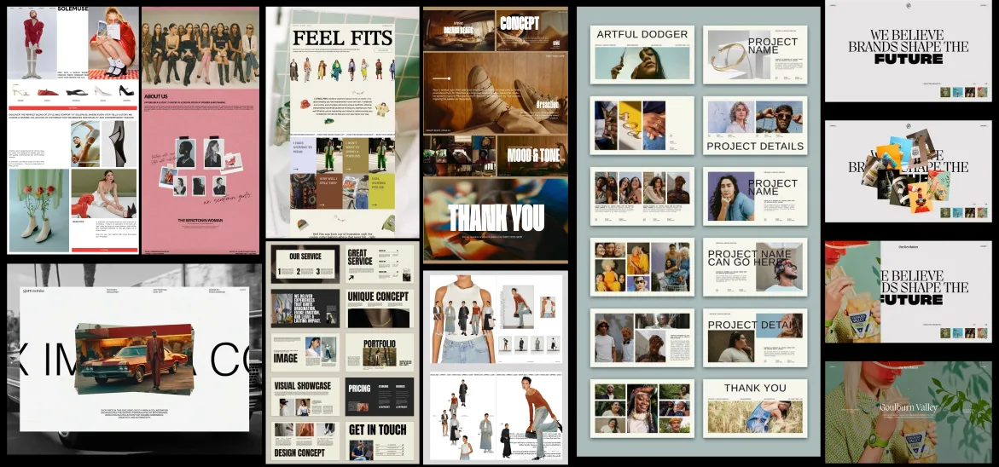
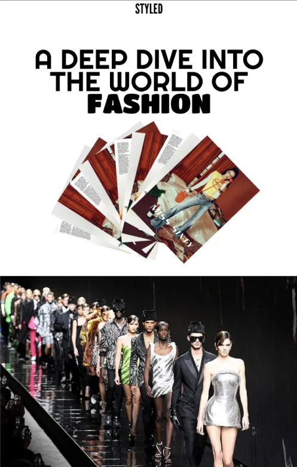
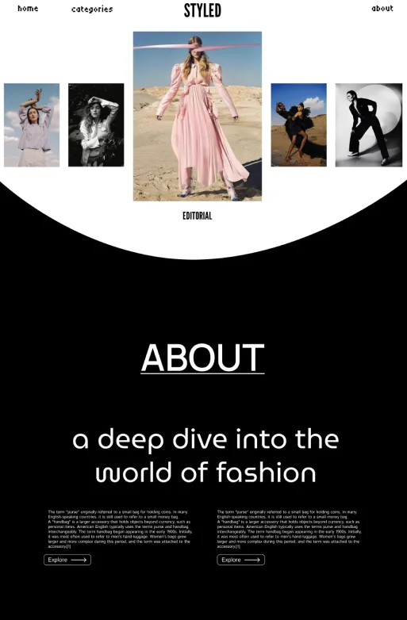
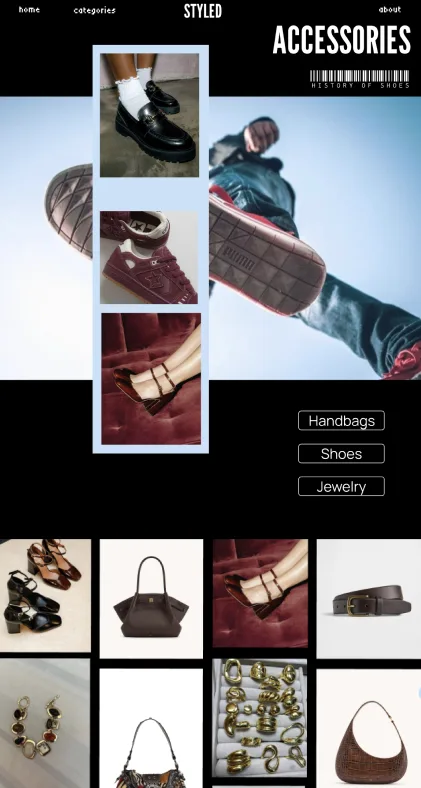
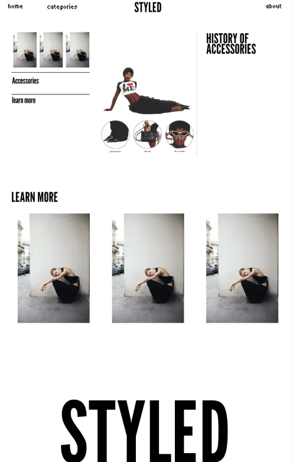

Styled is an editorial platform that explores the intersection of technology and culture in the modern digital age through the lens of fashion. The website examines how algorithms, AI and media systems shape our perception of style and taste: how what we wear, like and share is increasingly influenced by digital curation rather than individual choice.

## Problem

Digital media is increasingly shaped by algorithms, AI and platform-driven curation. While content feels fast and accessible, it also risks losing individuality and turning personal taste into something optimised rather than intentional.

The challenge of Styled was to reimagine the traditional fashion editorial experience in a digital format that encourages users to question how their style, taste and identity are shaped through technology, with a focus on creating an interface that invites reflection rather than passive scrolling.

## Concept & visual research

Inspired by traditional fashion magazines, Styled reimagines the editorial experience through a digital and analytical perspective. It blends curated visuals, interactive layouts and cultural commentary to invite viewers to engage in self-reflection.

  
<h4>Goal</h4>
Create an immersive and reflective experience that analyses how technology curates our taste, merging visual storytelling with accessible knowledge.

  
<h4>Approach</h4>
Treat the website like a fashion magazine: curated visuals, bold editorial layouts and commentary that asks the reader to think, not just scroll.

### Visual inspiration

## Initial concept sketches

## Design development

The design evolved from abstract, content-heavy mockups to a more cohesive and rhythmic layout system. I focused on creating a clear typographic hierarchy, layered motion and responsive components that allow the content to feel alive and adaptive across devices.

### Mid-fidelity wireframes

  <figure style="--ar:.727"><figcaption><b>Desktop</b></figcaption></figure>
  <figure style="--ar:1.318"><figcaption><b>Mobile</b></figcaption></figure>

### Style guide & components

  <figure style="--ar:.942"><figcaption><b>Style guide</b></figcaption></figure>
  <figure style="--ar:1.113"><figcaption><b>Components</b></figcaption></figure>

## Final designs

Styled was designed to encourage users to slow down, read and reflect rather than passively absorb content. The structure of the site plays a big role in this experience. Instead of choosing sources that simply inform, I selected texts that reflect the current and future landscape of digital media and fashion.

  
<h4>Part 01</h4>
Digital culture and identity

  
<h4>Part 02</h4>
Algorithmic influence

  
<h4>Part 03</h4>
Fashion systems and micro-trends

The content is organised as a three-part journey. This progression guides users through the ideas in a way that encourages reflection and allows them to draw their own conclusions, directly reinforcing the themes the project explores.

### Desktop

  <figure style="--ar:1.778"><video src="/media/styled/desktop-2.mp4" autoplay muted loop playsinline data-expand aria-label="Desktop: sections"></video></figure>
  <figure style="--ar:1.778"><video src="/media/styled/desktop-3.mp4" autoplay muted loop playsinline data-expand aria-label="Desktop: content"></video></figure>

### Mobile

  <figure style="--ar:.5625"><video src="/media/styled/mobile-1.mp4" autoplay muted loop playsinline data-expand aria-label="Mobile: home"></video></figure>
  <figure style="--ar:.5625"><video src="/media/styled/mobile-2.mp4" autoplay muted loop playsinline data-expand aria-label="Mobile: content"></video></figure>

## Reflection

Creating Styled helped me translate critical theory into design practice. It pushed me to think beyond aesthetics and focus on how interfaces influence behaviour and perception. From a design standpoint, the project strengthened my ability to:

  
<h4>01</h4>
Build cohesive visual systems across multiple screen sizes

  
<h4>02</h4>
Balance bold editorial layouts with functional UI

  
<h4>03</h4>
Translate abstract cultural ideas into concrete interface decisions

Conceptually, Styled became both an archive and a guided, informative experience, documenting digital fashion culture while also reflecting how AI, algorithms and media shape identity in a hyperconnected world.
