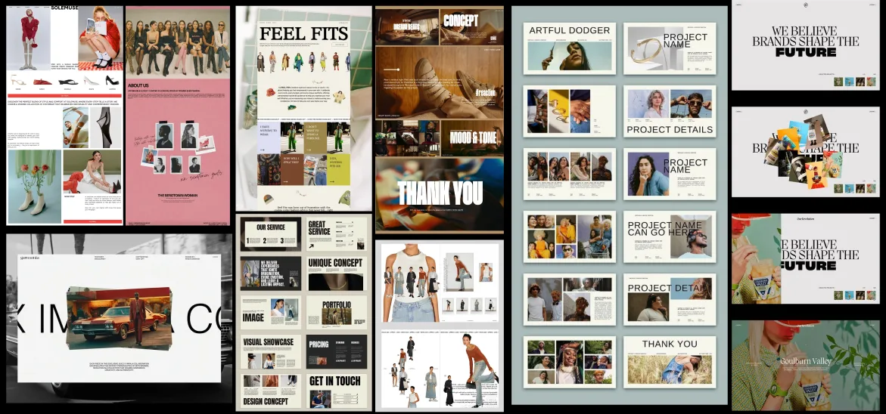
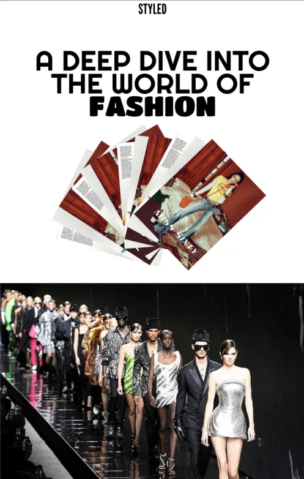
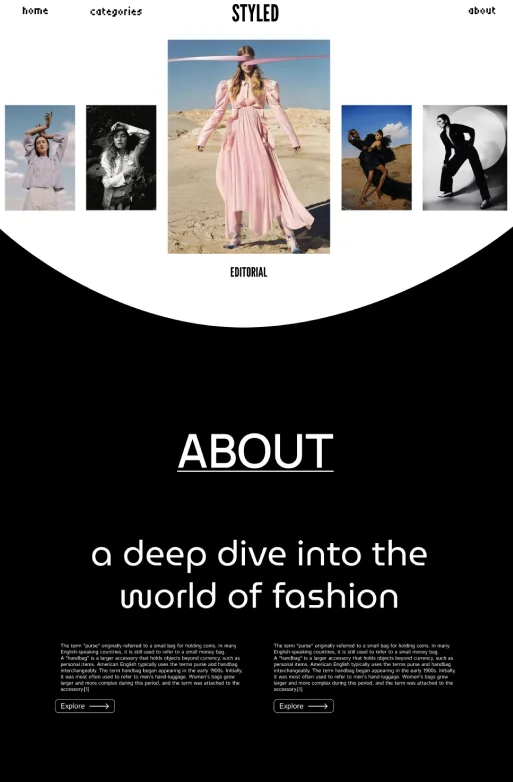
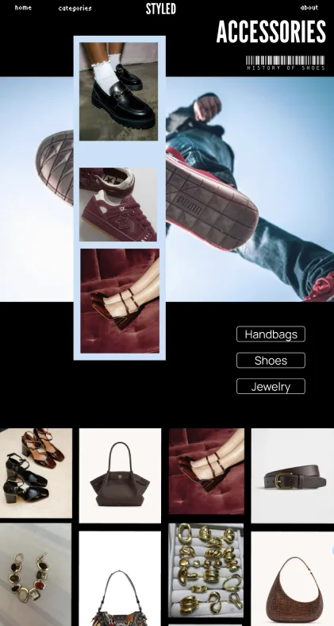
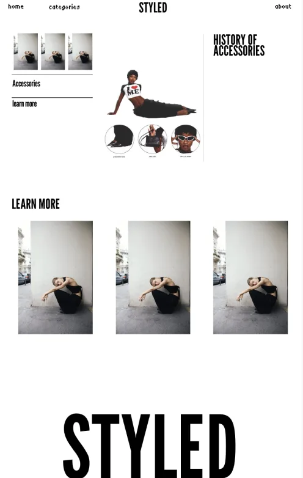
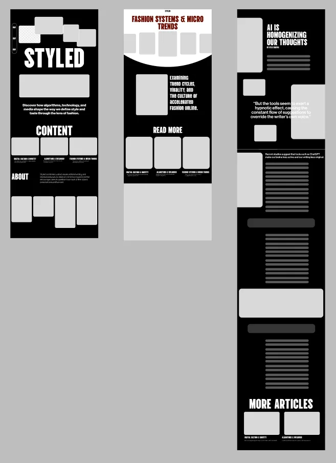
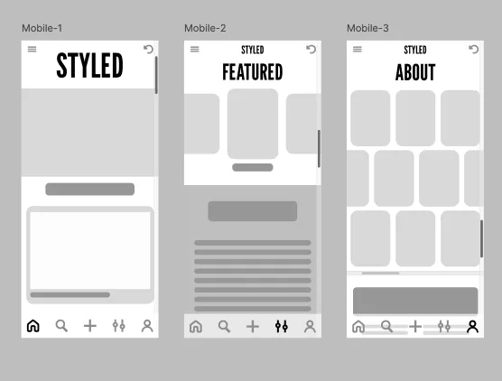
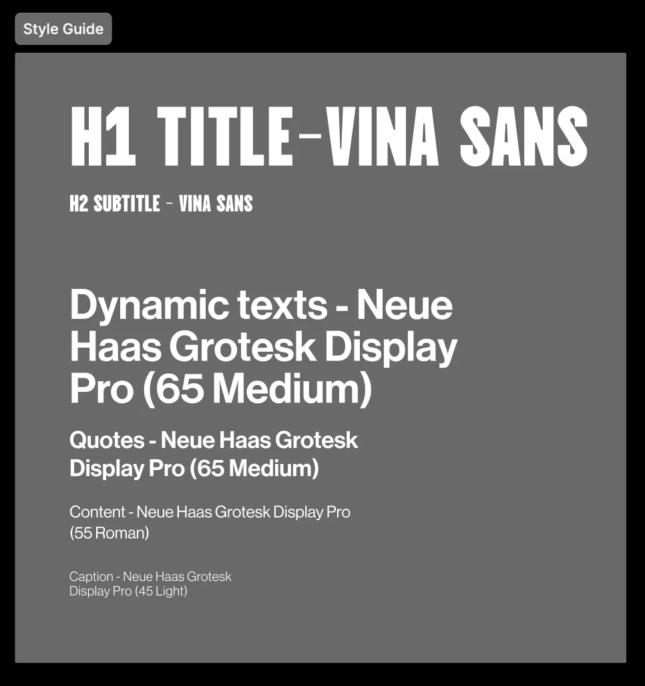
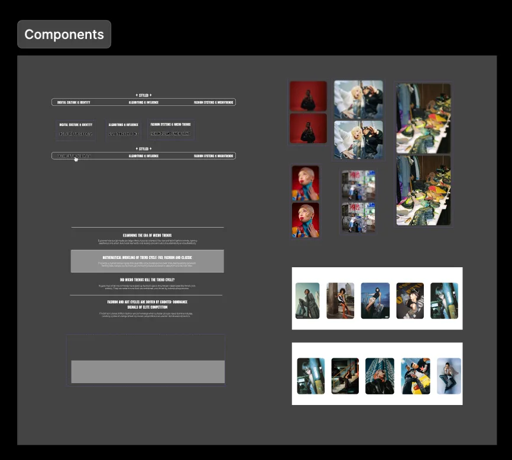

[Two or three sentences: the question behind Styled — how much of our style is personal, and how much is influenced?]

## Inspiration

## Ideation

## Structure

## System

## The experience

## Credits

[Course, collaborators.]
